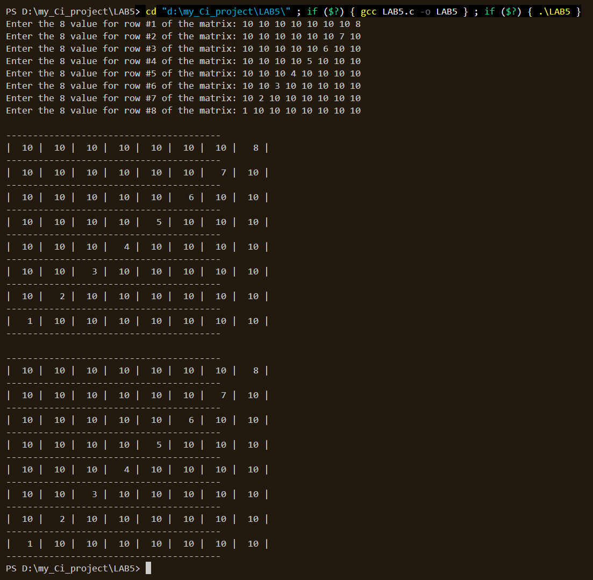
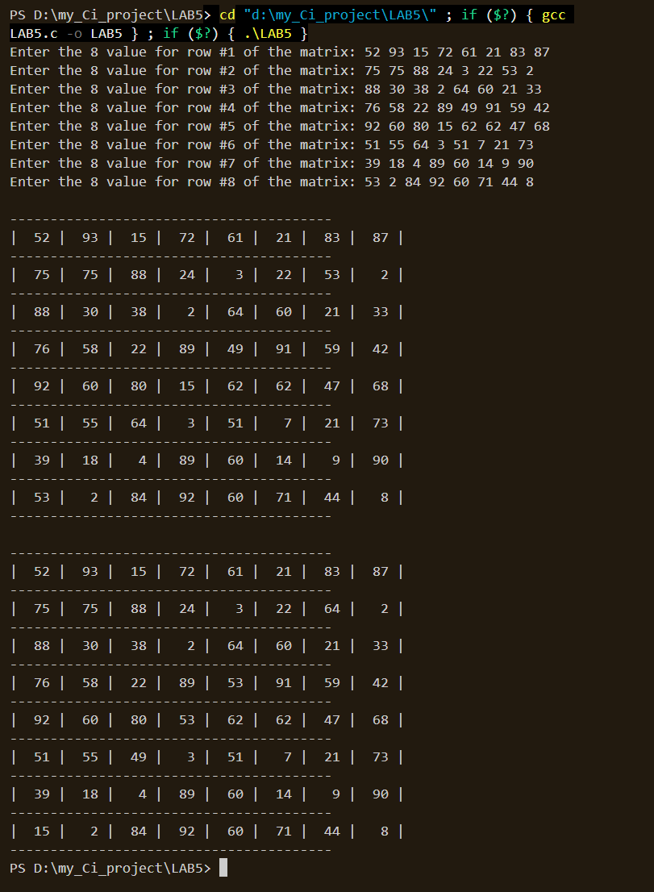

# olshanivskyi_lab5 (Ольшанівський Максим)
SDA fourth lab
### Національний технічний університет України
### «Київський політехнічний інститут імені Ігоря Сікорського»
### Факультет інформатики та обчислювальної техніки
### Кафедра обчислювальної техніки
---
### Cтруктури даних і алгоритми
### Лабораторна робота №4
### «Алгоритми двійкового пошуку»
---
#### Виконав:
#### студент групи ІО-61
#### Ольшанівський М. В.
#### Номер у списку групи: 20
#### Перевірив
#### Русінов В. В.


# Лабораторна робота №4
## Мета лабораторної роботи: 
Засвоєння теоретичного матеріалу та набуття практичних навичок розв'язання задачі пошуку заданої категорії елементів за допомогою різних алгоритмів методу двійкового пошуку у двовимірних масивах.

## Постановка задачі:
1. Написати програму розв'язання задачі пошуку (за варіантом) у двовимірному масиві (матриці) методом двійкового пошуку. Конкретний алгоритм двійкового пошуку (№1 або №2) задається варіантом завдання.
2. Розміри матриці m та n взяти самостійно в межах від 7 до 10.
3. При тестуванні програми підбирати такі вхідні набори значень матриці, щоб можна було легко відстежити коректність виконання пошуку, і щоб ця коректність була протестована для всіх можливих випадків. З метою тестування дозволяється використовувати матриці меншого розміру.

## Варіант 20
Задано квадратну матрицю дійсних чисел A[n,n]. Визначити присутність у головній діагоналі матриці будь-якого з чисел діапазону [0,5] і його місцезнаходження (координати) методом двійкового пошуку (Алгоритм №2), якщо елементи цієї діагоналі впорядковані за незбільшенням.

## Програмний код
#### (Lab4.с)
```c
#include <stdio.h>
#define n 8

int main()
{
    int matrix[n][n];
    int length = sizeof(matrix[0]) / sizeof(matrix[0][0]) - 1, Temp;

    for (int i = 0; i < length + 1; i++)
    {
        printf("Enter the %d value for row #%d of the matrix: ", n, i+1);
        for (int j = 0; j < length + 1; j++)
        {
            scanf("%d", &matrix[i][j]);
        }

    }

    // вивід матриці
    printf("\n----------------------------------------\n");
    for (int i = 0; i < length + 1; i++)
        {
            for (int j = 0; j < length + 1; j++)
            {
                printf("|%4d ", matrix[i][j]);
            }
            printf("|\n----------------------------------------\n");
        }

    // реалізація діапазону [0, 5]
    int left_border = 0, right_border = 5;

    int low_index = 0, 
    high_index = length, 
    index_search_item = -1;

    while (low_index <= high_index)
    {
        int mid_index = (low_index + high_index) / 2;
        int guess = matrix[mid_index][mid_index];

        if (guess >= left_border && guess <= right_border)
        {
            index_search_item = mid_index;
            high_index = mid_index - 1;
        }

        else if (guess > right_border)
        {
            low_index = mid_index + 1;
        }

        else
        {
            high_index = mid_index - 1;
        }
        
    }

    if (index_search_item != -1)
    {
        printf("Search number is %.2f and under index (%d, %d)\n", matrix[index_search_item][index_search_item], index_search_item, index_search_item);
    }
    else
    {
        printf("This array doesn't contain any numbers in the range[0, 5]");
    }
    
    return 0;
}
```
## Скріншоти виконна першої умови
#### - вже відсортований початковий стан масиву;

## Скріншоти виконна другої умови
#### - невідсортований початковий стан масиву (масив заповнений випадковими числами);

## Скріншоти виконна третьої умови
#### - обернено відсортований (відносно заданого за завданням порядку) початковий стан масиву.


## Висновок:
### У ході виконання даної лабораторної я дізнався та практично засвоїв знання з використання алгоритмів сортування, зокрема алгоритм сортування методом вибору, на прикладі сортування побічної діагоналі квадратної матриці за незбільшенням з трьома початковими вводними даними.
### Якщо стоїть питання, у якому випадку алгоритм працює найшвидше/найповільніше, то відповідь в усіх трьох варіантах алгоритм сортування виконується з однаковою "швидкістю" за O(n²). Якщо ж питання стоїться, у якому з варіантів алгоритм виконає найбільшу та найменшу кількість перестановок, то відповідь мінімальну кількість перестановок **R = 3(n-1)** при впорядкованих даних, та максимальну **R = n2/4 + 3(n-1)** при оберненій впорядкованості.

